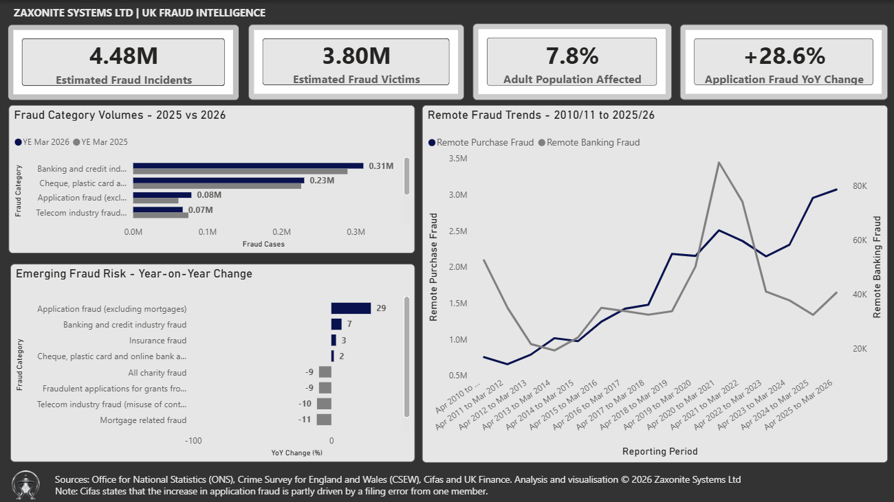
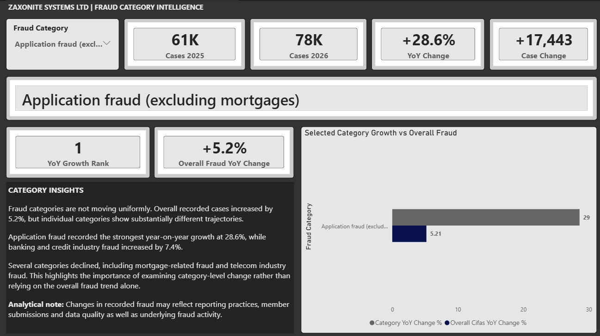
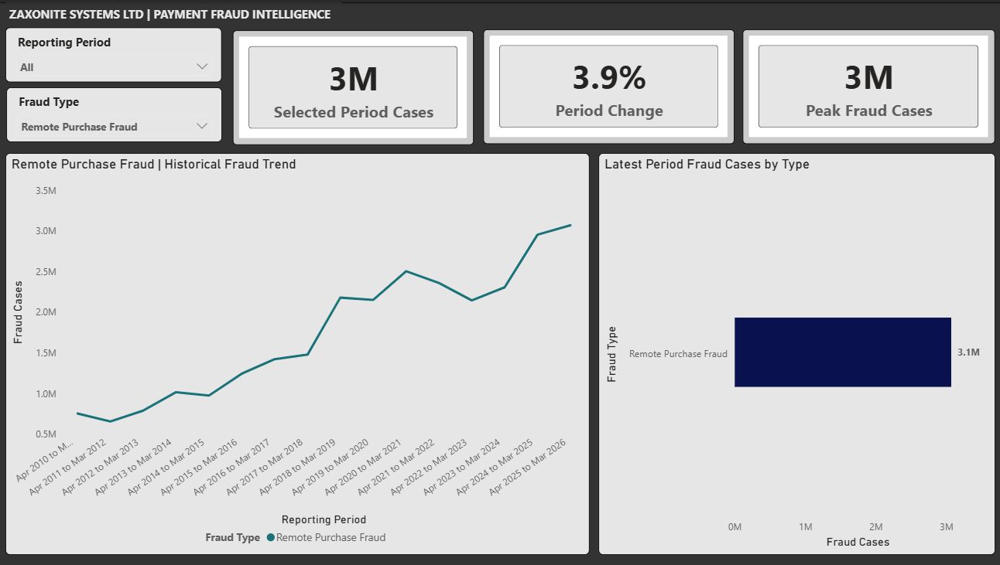

# Zaxonite Fraud Intelligence 2026

A Power BI fraud intelligence project analysing UK fraud patterns using publicly available data from the Office for National Statistics (ONS), Crime Survey for England and Wales (CSEW), Cifas and UK Finance.

The project combines data preparation, validation, analysis, interactive Power BI reporting and a written intelligence report.

## Executive Overview

The executive dashboard provides a high-level view of the UK fraud landscape, including estimated fraud incidents, victims, victim rate, category volumes, year-on-year change and longer-term fraud trends.

## Fraud Category Intelligence

The category analysis compares recorded fraud cases between the year ending March 2025 and the year ending March 2026.

Key findings include:

- Overall Cifas cases increased by approximately 5.2%.
- Application fraud excluding mortgages increased by 28.6%.
- Banking and credit industry fraud increased by approximately 7.4%.
- Several categories, including mortgage-related and telecom industry fraud, declined.

The application fraud increase should be interpreted with the relevant Cifas data caveat. Cifas states that the increase was partly affected by a filing error from one member.

## Payment Fraud Intelligence

Historical payment fraud data is used to examine how individual fraud types have changed over time.

The dashboard supports analysis by reporting period and fraud type, allowing longer-term trends, period changes and peak case volumes to be explored.

## Analytical Approach

The analysis considers both case volume and percentage change.

This distinction is important because a rapidly growing category may indicate emerging movement, while a slower-growing high-volume category can still represent a greater number of additional recorded cases.

Missing historical observations are retained as unavailable values rather than being treated as zero.

ONS/CSEW, Cifas and UK Finance data are analysed separately because the sources use different definitions, collection methods and reporting structures.

## Tools

- Microsoft Power BI
- Power Query
- DAX
- Data cleaning and validation
- Exploratory data analysis
- Data visualisation
- Analytical reporting

## Full Report

The accompanying report provides the findings, methodology, limitations and source information used within the analysis.

[View the Zaxonite Fraud Intelligence Report 2026](report/Zaxonite_Fraud_Intelligence_Report_2026.pdf)

## Data Sources

- Office for National Statistics (ONS)
- Crime Survey for England and Wales (CSEW)
- Cifas
- UK Finance

The underlying statistics remain the responsibility of their respective publishers. Zaxonite Systems Ltd prepared the analysis and visualisation presented in this project.

## About This Repository

This repository is a public demonstration of data analysis and Power BI reporting produced by Zaxonite Systems Ltd.

The Power BI development file and underlying working datasets are not included in the public repository.

**Zaxonite Systems Ltd**  
Data Analysis | Identity & Fraud Intelligence  
https://zaxonite.com